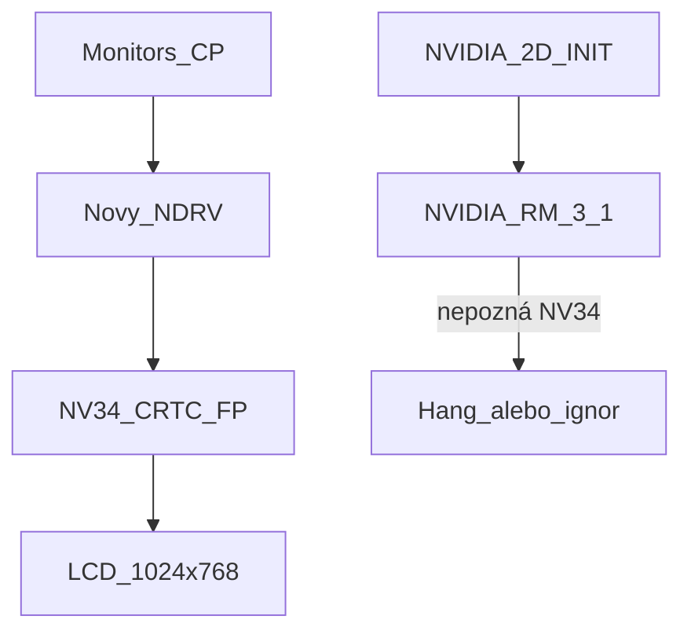

# Go5200 na Mac OS 9: režimy najprv, 2D neskôr

NVIDIA 3.1 z roku 2002 Go5200 nepozná a binárnym doplnením PCI ID sa to nedá opraviť. Reálne je napísať nový minimálny NDRV pre zmenu rozlíšenia a color depth; 2D akceleráciu skúsiť až potom.

## Úlohy

- [x] Získať z PB 6,2 OF/OS X properties — [docs/faza0-hw.md](docs/faza0-hw.md) (device-id `0329`, BAR0 `0x91000000`, FB `0xa0000000`)
- [x] Vybrať hotový NDRV — ROM uzla obsahuje iba Apple COFB (nie NVIDIA); OS X kexty netreba, vlastný driver funguje ([docs/faza1.md](docs/faza1.md))
- [x] Retro68 skeleton: DoDriverIO, TheDriverDescription, match `NVDA,NVMac` + `built-in` + PMC_BOOT_0 = NV34, mapovanie MMIO/FB z Name Registry ([driver/](driver))
- [x] Implementovať mode list 1024x768/800x600/640x480 @ 8/16/32 bpp cez NV34 CRTC/FP (nouveau dispnv04)
- [x] Otestovať Monitors CP na hardvéri — 4.0d4 (2026-10-05): rozlíšenia aj hĺbky fungujú; kľúč bol výber hlavy 1 ([docs/faza0-hw.md](docs/faza0-hw.md)). Zostáva: 256-color hra, opakovaný boot v nenatívnom režime
- [x] Zhodnotiť 2D — [docs/faza3.md](docs/faza3.md): čítanie VRAM ~12 MB/s pri každej šírke prístupu, write-through bez účinku, COFB rovnako pomalý
- [x] 2A oživenie PFIFO/PGRAPH podľa xf86-video-nv + test `NV34 Accel` — GPU blit 1.2 GB/s vs CPU 8 MB/s (tile regióny z OF ponechať)
- [x] 2B napojenie na QuickDraw — `NV34 QD Accel` 1.5 (INIT: 68k stub + PPC fragment, patch CopyBits obrazovka→obrazovka vrátane 1-bit aliasu screenBits); čas Findera v CopyBits 25–31 s → 1.2 s
- [x] Overiť 256 / Thousands / Millions s akceleráciou a prepínanie hĺbky za behu (1.5, 2026-10-14); uspanie na PB 6,2 v OS 9 nefunguje vôbec, netestovateľné
- [x] Fáza 4 OpenGL ([docs/faza4-opengl.md](docs/faza4-opengl.md)) — M1 ✔ prvé trojuholníky z 3D enginu (gl-3); M2 ✔ textúry, blending, z-buffer (gl-8); M3 NV34 RAVE engine: 32 bpp ✔ (rave-2), 16 bpp ✔ (rave-3/4), M3a ✔ NV34 RAVE engine — UT plne funkčný cez RAVE (rave-24); M4 ✔ NV34 MiniGL — vlastná OpenGLLibrary, Quake II plne funkčný (54 fps timedemo po optimalizácii, minigl-13); UT svetlo opravené (getInt 1011 = 772); M5 ✔ Half-Life cez MiniGL (hl-12); M6 ✔ Quake III cez MiniGL (q3-7, 37 fps timedemo po opt-8)

## Verdikt

**Pridať podporu do existujúceho [NVIDIA Driver](NVIDIA-v3.1-2002/NVIDIA%20Driver) (v3.1, marec 2002) sa nedá.** Balík je čistá PowerPC PEF binárka bez zdrojov. GeForce FX Go5200 (NV34M) vyšla až v roku 2003 — driver končí na GeForce4 / NV17–NV25. OpenGL ICD nemá FX/NV34 cesty, Resource Manager číta chip ID z `PMC.boot0` a pre NV34 (`0x034x`) nemá init.

Náhodné `0x0324` v binárke (za stringom `panelinfo`) nie je tabuľka PCI ID. Na PowerBook 6,2 je karta typicky **`10DE:0329`**, nie `0324` ([XFree86 report](https://www.spinics.net/lists/xfree86/msg01952.html)).

OS X driver (NVDAResman + NVDANV30Hal) **nejde** preložiť na OS 9. Je to IOKit kext, nie `ndrv`. Dá sa použiť len ako referencia registrov.

Komunita to isté riešila pri ATI (darthnVader / Jasper NDRV): **nový alebo extrahovaný NDRV dá režimy bez akcelerácie**. Pre Go5200 na PB 6,2 to doteraz nikto nedodal — na macos9lives ostali na Thousands of colours.

Dôležité rozlíšenie:

- **Zmena rozlíšenia / color depth** = Video Driver API (`cscSwitch`, `cscGetModeTiming`, `cscSetEntries`) v NDRV. QuickDraw 2D na to netreba.
- **2D akcelerácia** = samostatný INIT (`NVIDIA 2D Acceleration`) + Resource Manager, ktorý musí vedieť NV34 2D objekty (`0x0362` surf2d). To 3.1 nemá.



Balík [NVIDIA-v3.1-2002](NVIDIA-v3.1-2002/) **nainštalovať na PB 6,2 netreba** — RM môže pri neznámom chipclass hangnúť. Režimy pôjdu cez nový extension.

## Fáza 0 — dump z hardvéru

Na PowerBooku v Open Firmware (alebo z OS X):

```
dev agp/@10/@0 .properties
```

(prípadne `dev pci` a nájsť `NVDA` / `display`)

Potrebné properties:

- `vendor-id` / `device-id` (očakávané `10de` / `0329` alebo `0328`/`0324`)
- `compatible` (`NVDA,NVMac` a pod.)
- `assigned-addresses` (MMIO + FB)
- `AAPL,address`, `width`, `height`, `depth`, `linebytes`
- `EDID` / `display-cfg` / `NVDA,Display-A`
- `backlight-control`

Tieto hodnoty pôjdu do NDRV ako mode list a mapovanie registrov. Bez nich sa dá začať so známymi defaultmi 12" panelu (1024×768), ale matchovanie karty musí rozpoznať skutočné PCI ID.

## Fáza 1 — rýchly pokus: OS X NDRV fragment

ATI cesta (vybrať `driver,AAPL,MacOS,PowerPC` z OS X kextu a dať do Extensions) pri NVIDII často zlyhá, lebo diskový NVIDIA NDRV volá **ResMan**. Stojí to ale za jeden test:

- Z OS X 10.3.9 / 10.4 na tom istom stroji vybrať fragmenty z `GeForce.kext` / `NVDA*.kext` (katalóg [elliotnunn/x-ndrv](https://github.com/elliotnunn/x-ndrv)).
- Skopírovať do OS 9 `Extensions`, NVIDIA 3.1 **nedávať**.
- Ak Monitors CP začne ponúkať režimy, hotovo pre fázu 1.
- Ak driver nenačíta ResMan a zlyhá, pokračovať fázou 2.

## Fáza 2 — nový minimálny NDRV (hlavná cesta)

Nový PowerPC PEF `ndrv` / `vido` (šablóna: [QemuMacDrivers qemu_vga.ndrv](https://github.com/qemu/qemu) / Apple Native Driver docs, API z `Video.h`).

Build: [Retro68](https://github.com/autc04/Retro68) na tomto Macu (cross-compile PEF), nie patchovanie 3.1.

Driver bude:

1. **Match** cez Name Registry: `device-id` Go5200 + `NVDA,NVMac` / `device_type=display`.
2. Namapovať MMIO (`assigned-addresses`) a framebuffer.
3. Implementovať minimálnu množinu volaní, ktorú Monitors CP a hry potrebujú:
   - `cscGetConnection`, `cscGetNextResolution`, `cscGetModeTiming`, `cscGetCurMode`
   - `cscSwitch` / `cscSetMode`
   - `cscGetBaseAddr`, `cscGrayPage`
   - `cscSetEntries` / `cscDirectSetEntries` (256 farieb)
   - voliteľne `cscSetGamma`, `cscGetPreferredConfiguration`
4. **Mode list pre interný 12" panel:** 1024×768, 800×600, 640×480 @ 8 / 16 / 32 bpp. Scaled módy cez NV34 FP scaler (nouveau `dispnv04` — NV04 až NV36 zdieľajú display engine). XFree86 `nv` na tomto chipseti (`0x0329`) už režimy vedel bez špecifického ID.
5. Color depth: prepis `CRTC` pitch/offset + formát framebufferu; 8-bit cez NVIDIA CLUT (PRAMDAC).
6. Obaliť ako OS 9 extension: `cfrg` (pwpc), `vers`, `TheDriverDescription` (`ndrv`+`vido`), rovnaký vzor ako v [NVIDIA Driver](NVIDIA-v3.1-2002/NVIDIA%20Driver) (`mtej` + `NVDA,NVMac` + `Display_NV`).

Hardvérová referencia (nie kód na OS 9):

- nouveau `drivers/gpu/drm/nouveau/dispnv04/` (CRTC, DAC, FP, overlay)
- envytools / nv34 docs
- OS X `NVDANV30Hal` len na porovnanie init/PLL, ak bude treba

Repo po implementácii: zdroj NDRV + Retro68 Makefile + návod na inštaláciu do `Extensions`. Pôvodný 3.1 balík ostane ako referencia, nebude sa patchovať.

## Test na stroji

1. NVIDIA 3.1 / ATI extensions vypnuté.
2. Nový NDRV do `System Folder:Extensions`, restart.
3. Monitors CP: Millions, Thousands, 256; 1024×768 a aspoň jeden scaled mód.
4. Hra alebo app, ktorá vyžaduje 256 farieb / iné rozlíšenie.
5. Ak obraz zmizne: Extensions Off, NDRV preč — OF framebuffer ostane ako záchrana.

## Fáza 3 — 2D akcelerácia (až po režimoch)

Až bude NDRV stabilný, zhodnotiť 2D. Realisticky:

- **Patch 3.1 RM na NV34: veľmi nepravdepodobné.** Iný chipclass, iný graph engine, iné 2D class IDs.
- **Vlastný 2D INIT** (surf2d/gdi blit cez MMIO, podľa nouveau `nv34_graph`) je samostatný projekt: FIFO, channels, context, endian. Bez toho ostane QuickDraw softvérový — OS 9 na G4 1 GHz je použiteľný, hry pomalšie.
- OpenGL / DVD z 3.1 pre FX **nesľubovať**.

## Riziká

- Zlý CRTC/PLL program = čierny LCD (odstrániť extension).
- Backlight (`mnca` vs `ati`) je samostatný problém; NDRV ho nemusí riešiť v prvej verzii.
- Externý mini-DVI / dual display je mimo prvého cieľa.
- Bez dumpnutého `device-id` sa NDRV nemusí na kartu naviazať.
