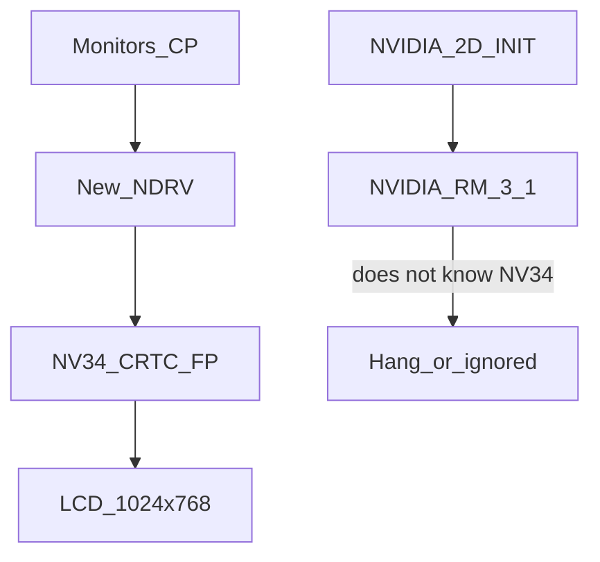

# Go5200 on Mac OS 9: display modes first, 2D later

NVIDIA's 3.1 driver from 2002 does not know the Go5200, and adding the PCI ID to the binary cannot fix that. What is realistic is writing a new minimal NDRV for changing resolution and color depth; 2D acceleration comes after that.

## Tasks

- [x] Get the OF/OS X properties from the PB 6,2 — [docs/phase0-hw.md](docs/phase0-hw.md) (device-id `0329`, BAR0 `0x91000000`, FB `0xa0000000`)
- [x] Pick a ready-made NDRV — the node ROM only contains Apple COFB (not NVIDIA); OS X kexts are not needed, our own driver works ([docs/phase1.md](docs/phase1.md))
- [x] Retro68 skeleton: DoDriverIO, TheDriverDescription, match `NVDA,NVMac` + `built-in` + PMC_BOOT_0 = NV34, MMIO/FB mapping from the Name Registry ([driver/](driver))
- [x] Implement the mode list 1024x768/800x600/640x480 @ 8/16/32 bpp via the NV34 CRTC/FP (nouveau dispnv04)
- [x] Test the Monitors control panel on hardware — 4.0d4 (2026-10-05): resolutions and depths work; the key was selecting head 1 ([docs/phase0-hw.md](docs/phase0-hw.md)). Remaining: a 256-color game, repeated boot in a non-native mode
- [x] Evaluate 2D — [docs/phase3.md](docs/phase3.md): VRAM reads ~12 MB/s at any access width, write-through has no effect, COFB is just as slow
- [x] 2A bring up PFIFO/PGRAPH per xf86-video-nv + the `NV34 Accel` test — GPU blit 1.2 GB/s vs CPU 8 MB/s (keep the OF tile regions)
- [x] 2B hook into QuickDraw — `NV34 QD Accel` 1.5 (INIT: 68k stub + PPC fragment, patches screen→screen CopyBits including the 1-bit screenBits alias); Finder time in CopyBits 25–31 s → 1.2 s
- [x] Verify 256 / Thousands / Millions with acceleration and depth switching at run time (1.5, 2026-10-14); sleep does not work at all on the PB 6,2 under OS 9, so it cannot be tested
- [x] Phase 4 OpenGL ([docs/phase4-opengl.md](docs/phase4-opengl.md)) — M1 ✔ first triangles from the 3D engine (gl-3); M2 ✔ textures, blending, z-buffer (gl-8); M3 NV34 RAVE engine: 32 bpp ✔ (rave-2), 16 bpp ✔ (rave-3/4), M3a ✔ NV34 RAVE engine — UT fully working through RAVE (rave-24); M4 ✔ NV34 MiniGL — our own OpenGLLibrary, Quake II fully working (54 fps timedemo after optimization, minigl-13); UT lighting fixed (getInt 1011 = 772); M5 ✔ Half-Life through MiniGL (hl-12); M6 ✔ Quake III through MiniGL (q3-7, 37 fps timedemo after opt-8)

## Verdict

**Adding support to the existing [NVIDIA Driver](NVIDIA-v3.1-2002/NVIDIA%20Driver) (v3.1, March 2002) is not possible.** The package is a plain PowerPC PEF binary without sources. The GeForce FX Go5200 (NV34M) only came out in 2003 — the driver ends at the GeForce4 / NV17–NV25. The OpenGL ICD has no FX/NV34 paths, and the Resource Manager reads the chip ID from `PMC.boot0` and has no init for NV34 (`0x034x`).

The stray `0x0324` in the binary (after the `panelinfo` string) is not a PCI ID table. On the PowerBook 6,2 the card is typically **`10DE:0329`**, not `0324` ([XFree86 report](https://www.spinics.net/lists/xfree86/msg01952.html)).

The OS X driver (NVDAResman + NVDANV30Hal) **cannot** be rebuilt for OS 9. It is an IOKit kext, not an `ndrv`. It can only serve as a register reference.

The community solved the same thing for ATI (darthnVader / Jasper NDRV): **a new or extracted NDRV gives display modes without acceleration**. Nobody had delivered that for the Go5200 in the PB 6,2 — on macos9lives they stayed at Thousands of colors.

An important distinction:

- **Changing resolution / color depth** = the Video Driver API (`cscSwitch`, `cscGetModeTiming`, `cscSetEntries`) in the NDRV. QuickDraw 2D is not needed for that.
- **2D acceleration** = a separate INIT (`NVIDIA 2D Acceleration`) + the Resource Manager, which would have to know the NV34 2D objects (`0x0362` surf2d). 3.1 does not.



The [NVIDIA-v3.1-2002](NVIDIA-v3.1-2002/) package **should not be installed on the PB 6,2** — the RM may hang on an unknown chip class. Display modes come from the new extension.

## Phase 0 — hardware dump

On the PowerBook in Open Firmware (or from OS X):

```
dev agp/@10/@0 .properties
```

(or `dev pci` and look for `NVDA` / `display`)

Properties needed:

- `vendor-id` / `device-id` (expected `10de` / `0329` or `0328`/`0324`)
- `compatible` (`NVDA,NVMac` etc.)
- `assigned-addresses` (MMIO + FB)
- `AAPL,address`, `width`, `height`, `depth`, `linebytes`
- `EDID` / `display-cfg` / `NVDA,Display-A`
- `backlight-control`

These values go into the NDRV as the mode list and register mapping. Without them we could start with the known defaults of the 12" panel (1024×768), but matching the card has to recognize the real PCI ID.

## Phase 1 — quick attempt: an OS X NDRV fragment

The ATI approach (take `driver,AAPL,MacOS,PowerPC` from an OS X kext and put it into Extensions) often fails for NVIDIA because the on-disk NVIDIA NDRV calls **ResMan**. It is still worth one test:

- From OS X 10.3.9 / 10.4 on the same machine, extract the fragments from `GeForce.kext` / `NVDA*.kext` (catalog: [elliotnunn/x-ndrv](https://github.com/elliotnunn/x-ndrv)).
- Copy them into the OS 9 `Extensions`, **without** NVIDIA 3.1.
- If the Monitors control panel starts offering modes, phase 1 is done.
- If the driver fails because ResMan is missing, continue with phase 2.

## Phase 2 — a new minimal NDRV (the main path)

A new PowerPC PEF `ndrv` / `vido` (template: [QemuMacDrivers qemu_vga.ndrv](https://github.com/ozbenh/QemuMacDrivers) / Apple Native Driver docs, API from `Video.h`).

Build: [Retro68](https://github.com/autc04/Retro68) on this Mac (cross-compiled PEF), not patching 3.1.

The driver will:

1. **Match** via the Name Registry: Go5200 `device-id` + `NVDA,NVMac` / `device_type=display`.
2. Map the MMIO (`assigned-addresses`) and the framebuffer.
3. Implement the minimal set of calls that the Monitors control panel and games need:
   - `cscGetConnection`, `cscGetNextResolution`, `cscGetModeTiming`, `cscGetCurMode`
   - `cscSwitch` / `cscSetMode`
   - `cscGetBaseAddr`, `cscGrayPage`
   - `cscSetEntries` / `cscDirectSetEntries` (256 colors)
   - optionally `cscSetGamma`, `cscGetPreferredConfiguration`
4. **Mode list for the internal 12" panel:** 1024×768, 800×600, 640×480 @ 8 / 16 / 32 bpp. Scaled modes through the NV34 FP scaler (nouveau `dispnv04` — NV04 through NV36 share the display engine). XFree86 `nv` already handled modes on this chipset (`0x0329`) without a specific ID.
5. Color depth: rewrite the `CRTC` pitch/offset + framebuffer format; 8-bit through the NVIDIA CLUT (PRAMDAC).
6. Package it as an OS 9 extension: `cfrg` (pwpc), `vers`, `TheDriverDescription` (`ndrv`+`vido`), the same pattern as in [NVIDIA Driver](NVIDIA-v3.1-2002/NVIDIA%20Driver) (`mtej` + `NVDA,NVMac` + `Display_NV`).

Hardware reference (not code for OS 9):

- nouveau `drivers/gpu/drm/nouveau/dispnv04/` (CRTC, DAC, FP, overlay)
- envytools / nv34 docs
- OS X `NVDANV30Hal` only for comparing init/PLL, if needed

The repo after implementation: NDRV sources + Retro68 Makefile + instructions for installing into `Extensions`. The original 3.1 package stays as a reference and will not be patched.

## Testing on the machine

1. NVIDIA 3.1 / ATI extensions disabled.
2. New NDRV into `System Folder:Extensions`, restart.
3. Monitors control panel: Millions, Thousands, 256; 1024×768 and at least one scaled mode.
4. A game or application that needs 256 colors / another resolution.
5. If the picture disappears: Extensions Off, remove the NDRV — the OF framebuffer remains as a fallback.

## Phase 3 — 2D acceleration (only after the display modes)

Once the NDRV is stable, evaluate 2D. Realistically:

- **Patching the 3.1 RM for NV34: very unlikely.** Different chip class, different graphics engine, different 2D class IDs.
- **Our own 2D INIT** (surf2d/gdi blit via MMIO, per nouveau `nv34_graph`) is a separate project: FIFO, channels, context, endianness. Without it QuickDraw stays in software — OS 9 on a 1 GHz G4 is usable, games are slower.
- **Do not promise** OpenGL / DVD from 3.1 for the FX.

## Risks

- A wrong CRTC/PLL setup = black LCD (remove the extension).
- Backlight (`mnca` vs `ati`) is a separate problem; the NDRV does not have to handle it in the first version.
- External mini-DVI / dual display is outside the first goal.
- Without the dumped `device-id` the NDRV might not bind to the card.
